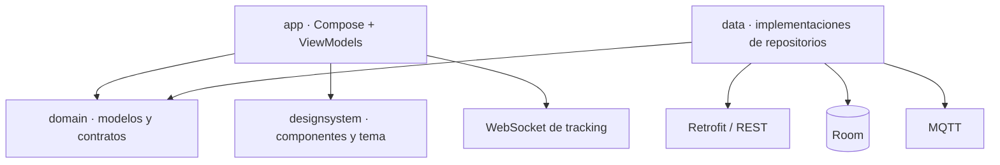
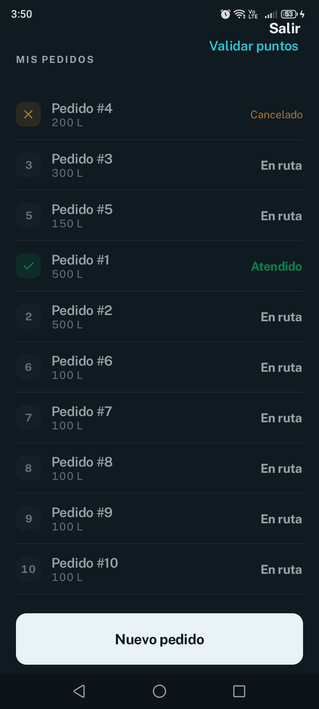
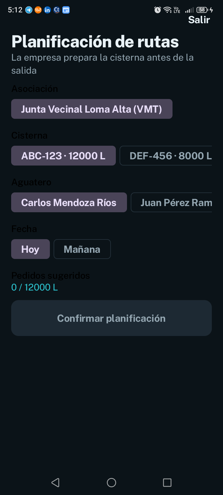
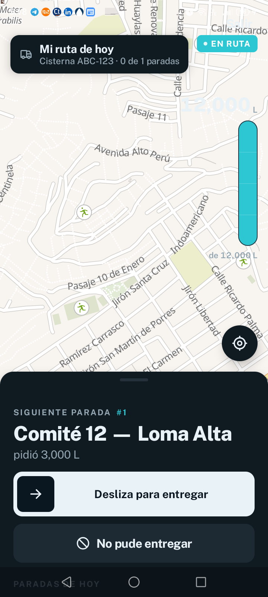
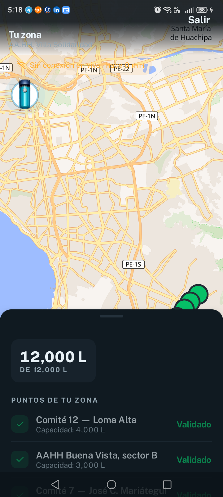

# EnRutaTuAgua App

[](https://kotlinlang.org/)
[](https://developer.android.com/)
[](https://developer.android.com/compose)
[](#arquitectura)
[]()

## Visión general

**EnRutaTuAgua** es una aplicación Android nativa para coordinar y visualizar la distribución de agua mediante camiones cisterna. Ofrece experiencias específicas para aguateros, presidentes de asociaciones, vecinos y operadores, conectadas al backend real mediante REST, MQTT y WebSocket.

La aplicación está desarrollada con Kotlin y Jetpack Compose. Su diseño modular separa interfaz, reglas de negocio, acceso a datos y sistema visual para facilitar pruebas, mantenimiento y evolución independiente.

## Características principales

- **Acceso por roles:** Aguatero, Presidente, Vecino y Operador.
- **Gestión de pedidos:** creación multipunto, prioridades, ventanas y consulta de estado.
- **Planificación operativa:** selección de cisterna, aguatero, fecha y pedidos de una ruta.
- **Ruta del aguatero:** carga, navegación, entregas parciales, omisiones y cierre.
- **Operación offline:** cola local en Room con reintentos y confirmación idempotente.
- **Seguimiento GPS:** publicación por MQTT y representación del rumbo de la cisterna.
- **Mapa del vecino:** posición en vivo mediante WebSocket y polling REST de respaldo.
- **Cadena de custodia:** recepciones y conciliación del agua para el Presidente.
- **Material Design 3:** interfaz declarativa, accesible y adaptable con Jetpack Compose.

## Arquitectura



### Módulos

| Módulo | Responsabilidad |
| --- | --- |
| `app` | Pantallas Compose, navegación, ViewModels, GPS e inyección de dependencias |
| `domain` | Modelos y contratos de repositorios independientes de Android |
| `data` | Retrofit, Room, MQTT, serialización y repositorios concretos |
| `designsystem` | Tema Material 3 y componentes visuales reutilizables |

El flujo habitual es `UI → ViewModel → repositorio de dominio → implementación data`. Hilt ensambla las dependencias y las corrutinas exponen estado reactivo a Compose.

## Tecnologías utilizadas

<div align="center">
  
  
  
  
  
  
  
</div>

## Guía de instalación

### Requisitos previos

- Android Studio con soporte para AGP 8.7.3.
- JDK 17.
- Android SDK 35.
- Dispositivo o emulador con Android 8.0 (API 26) o superior.
- Una instancia del backend EnRutaTuAgua.

### Configuración y ejecución

1. Clonar el repositorio:

   ```bash
   git clone https://github.com/ihackurass/EnRutaTuAgua-App.git
   cd EnRutaTuAgua-App
   ```

2. Ejecutar en el emulador usando los valores predeterminados (`10.0.2.2`):

   ```bash
   ./gradlew installDebug
   ```

3. Para un dispositivo físico, indicar la IP LAN del equipo que ejecuta el backend:

   ```bash
   ./gradlew installDebug \
     -PENRUTA_BASE_URL=http://192.168.1.10:8080/ \
     -PENRUTA_MQTT_BROKER=tcp://192.168.1.10:1883
   ```

En Windows, usar `gradlew.bat`. No guardar contraseñas MQTT en archivos versionados; `ENRUTA_MQTT_PASSWORD` puede proporcionarse como propiedad Gradle durante la compilación.

### Pruebas

```bash
./gradlew test
```

La suite incluye pruebas unitarias, ViewModels, repositorios, Compose con Robolectric y verificaciones visuales con Roborazzi.

## Capturas de pantalla

<div align="center">
  
  
  
  
</div>

## Comunicación con el backend

| Canal | Uso |
| --- | --- |
| REST + JWT | Sesiones, pedidos, rutas, entregas y custodia |
| MQTT | Publicación de posiciones GPS del aguatero |
| WebSocket | Actualización en vivo de la cisterna para el vecino |
| Room | Persistencia local y cola de acciones offline |

## Repositorio relacionado

- [Backend EnRutaTuAgua](https://github.com/ihackurass/EnRutaTuAgua-Backend)

## Contacto

Si tienes preguntas o sugerencias, puedes abrir un issue o contactar a [@ihackurass](https://github.com/ihackurass).

---

<div align="center">
  <sub>Hecho con ❤️ para el Perú. Tecnología para acercar el agua a quienes más la necesitan.</sub>
</div>
